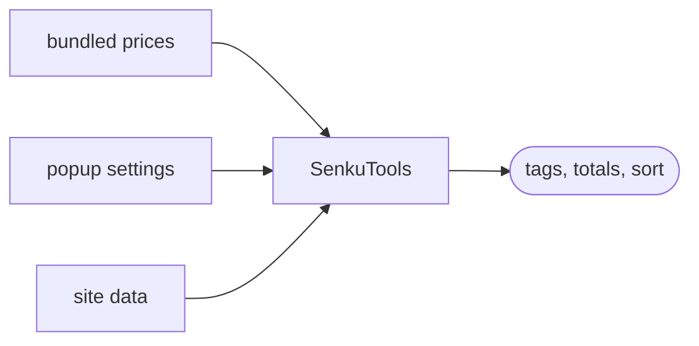

# SenkuTools

Prices on cards, trade totals and account tools for senkuro.me, shiruho.com and senkognito.com.

English | [Русский](README.ru.md)

      

## Features

Click the extension icon to open the settings.

- Prices on cards
- Trade totals
- Profile value
- Sort by price
- Fresh card lists
- Cards and shards switch
- Better site search
- Copy a card's name (off by default)
- Avatar price warning
- Token bar (off by default)

## Install

Download from the [latest release](https://github.com/Antawq/senkuro-tools/releases/latest).

- **Chrome, Edge, Brave, Opera:** unzip `senkutools-<version>-chrome.zip`, open `chrome://extensions`, turn on Developer mode, press Load unpacked and pick the folder.
- **Firefox:** the build is unsigned. Open `about:debugging#/runtime/this-firefox`, press Load Temporary Add-on and pick `senkutools-<version>.xpi`. A restart removes it.
- **Zen, Developer Edition, Nightly:** set `xpinstall.signatures.required` to `false` in `about:config`, then install the `.xpi` from `about:addons` (gear menu, Install Add-on From File).

## Privacy

- No analytics.
- Talks only to the supported sites and their APIs.
- Prices are bundled, not fetched.
- The token is read only while the token bar is on and is never sent anywhere.
- Permissions: `storage`, `clipboardWrite`, `cookies` (the `access_token` cookie, for the token bar) and the six site hosts.

## Development

`npm install`, then `npm run dev`, `npm run build`, `npm test` and `npm run zip`. Commits follow [Conventional Commits](https://www.conventionalcommits.org) in English.

## Support

[@SenkuTools](https://t.me/SenkuTools) on Telegram or an [issue](https://github.com/Antawq/senkuro-tools/issues). Author: phaivroh ([.com](https://senkuro.com/users/phaivroh), [.me](https://senkuro.me/users/phaivroh)). Thanks to Anta ([.com](https://senkuro.com/users/chu), [.me](https://senkuro.me/users/chu)).
