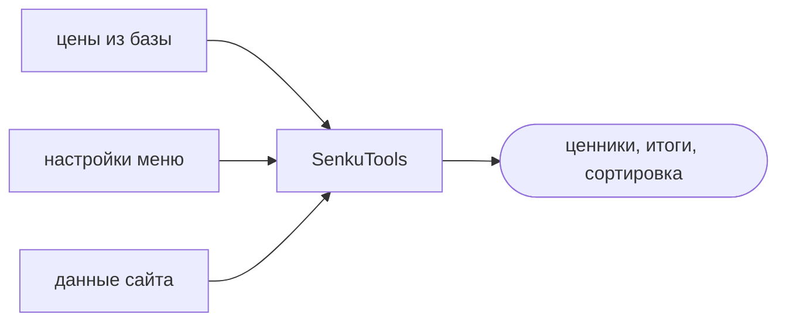
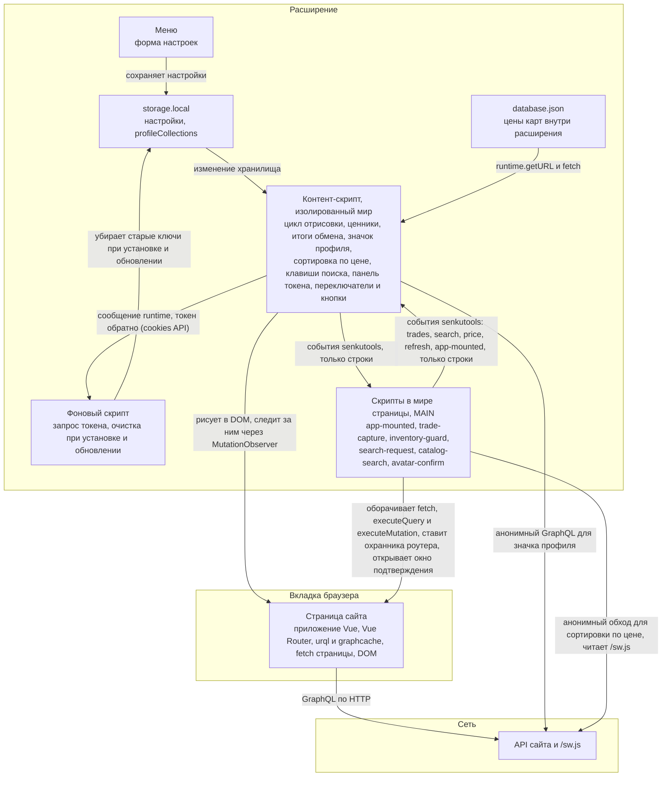
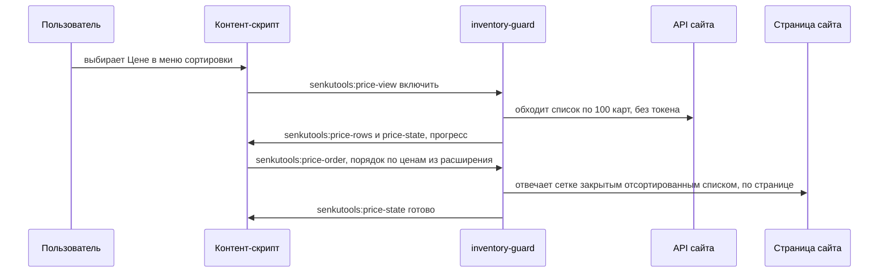
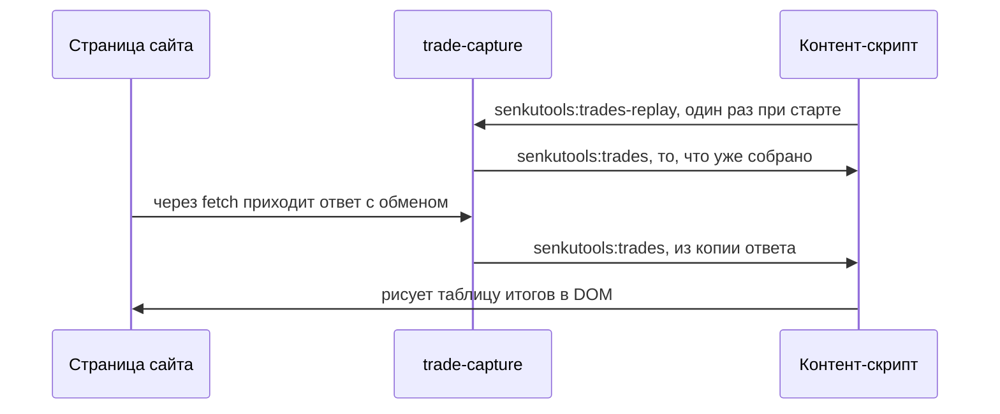
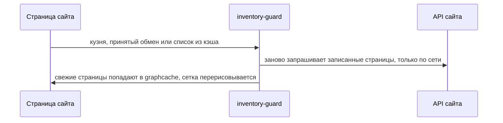
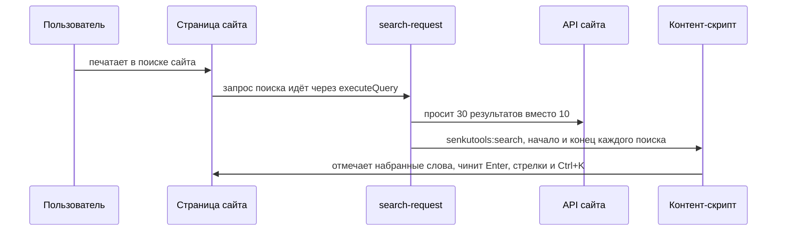
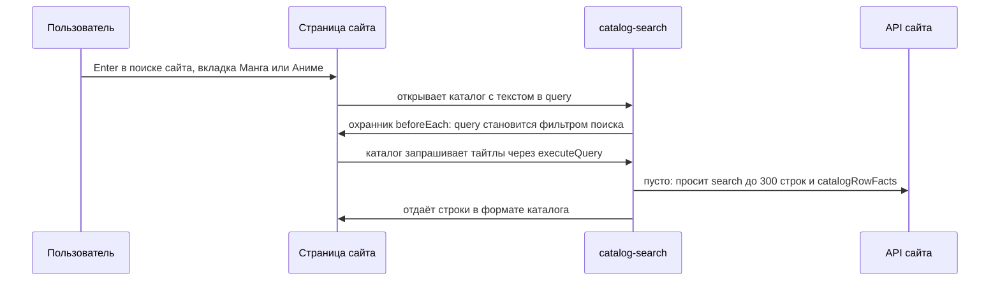
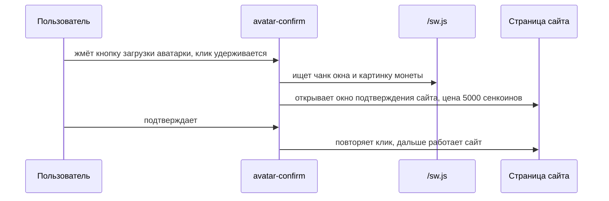
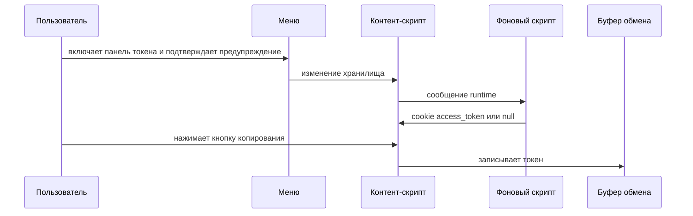

# SenkuTools

Цены на картах, итоги обменов и инструменты аккаунта для senkuro.me, shiruho.com и senkognito.com.

[English](README.md) | Русский

      

## Возможности

Настройки открываются по значку расширения.

- Цены на картах
- Итоги обмена
- Ценность профиля
- Сортировка по цене
- Свежие списки карт
- Переключатель карт и осколков
- Улучшенный поиск сайта
- Копирование имени карты (по умолчанию выключено)
- Предупреждение о цене аватарки
- Панель токена (по умолчанию выключена)

Как это устроено подробно

**Где что работает**

**Сортировка по цене**

**Итоги обмена**

**Свежие списки карт**

**Поиск сайта**

**Поиск в каталоге**

**Предупреждение о цене аватарки**

**Панель токена**

## Установка

Файлы лежат в [последнем релизе](https://github.com/Antawq/senkuro-tools/releases/latest).

- **Chrome, Edge, Brave, Opera:** распакуйте `senkutools-<версия>-chrome.zip`, откройте `chrome://extensions`, включите режим разработчика, нажмите «Загрузить распакованное» и выберите папку.
- **Firefox:** сборка не подписана. Откройте `about:debugging#/runtime/this-firefox`, нажмите «Загрузить временное дополнение» (Load Temporary Add-on) и выберите `senkutools-<версия>.xpi`. После перезапуска оно пропадёт.
- **Zen, Developer Edition, Nightly:** в `about:config` поставьте `xpinstall.signatures.required` в `false`, затем установите `.xpi` через `about:addons` (шестерёнка, Install Add-on From File).

## Приватность

- Аналитики нет.
- Обращается только к поддерживаемым сайтам и их API.
- Цены лежат внутри расширения.
- Токен читается только при включённой панели и никуда не отправляется.
- Разрешения: `storage`, `clipboardWrite`, `cookies` (cookie `access_token`, для панели токена) и шесть адресов сайтов.

## Разработка

`npm install`, затем `npm run dev`, `npm run build`, `npm test` и `npm run zip`. Коммиты пишутся по [Conventional Commits](https://www.conventionalcommits.org) на английском.

## Связь

[@SenkuTools](https://t.me/SenkuTools) в Telegram или [issue](https://github.com/Antawq/senkuro-tools/issues). Автор: phaivroh ([.com](https://senkuro.com/users/phaivroh), [.me](https://senkuro.me/users/phaivroh)). Благодарность: Anta ([.com](https://senkuro.com/users/chu), [.me](https://senkuro.me/users/chu)).
