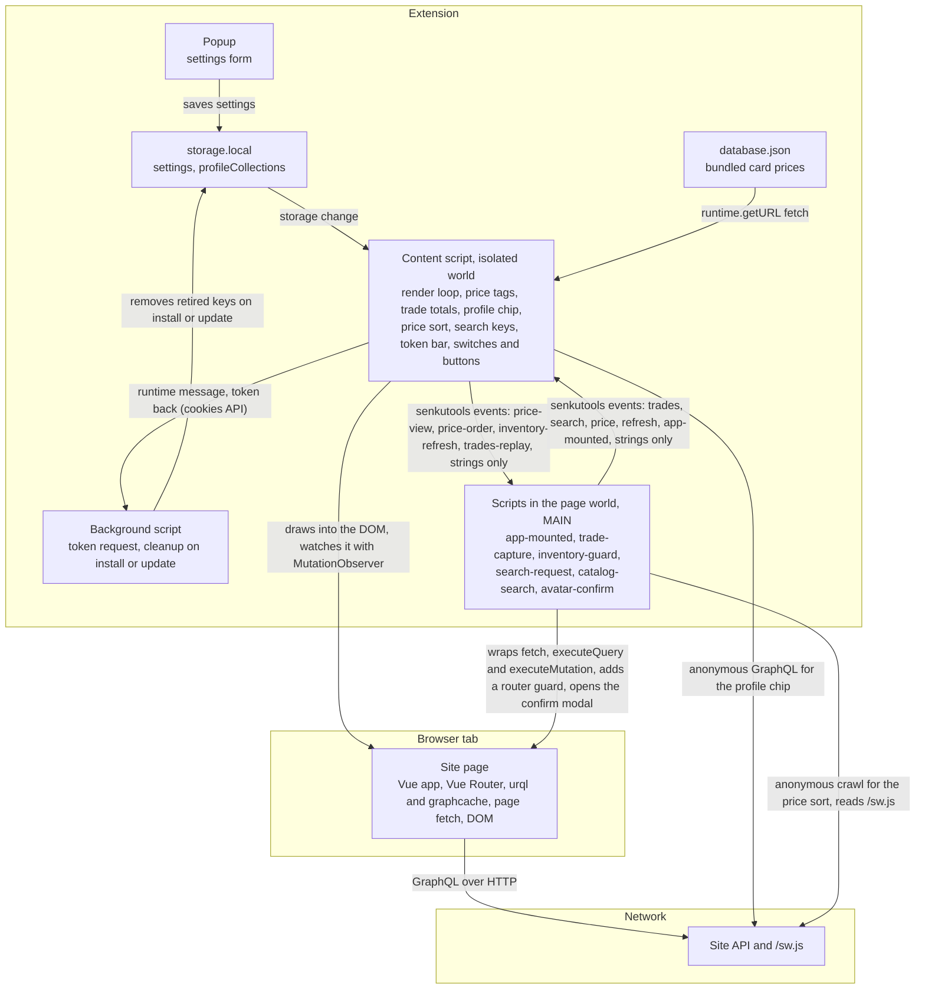
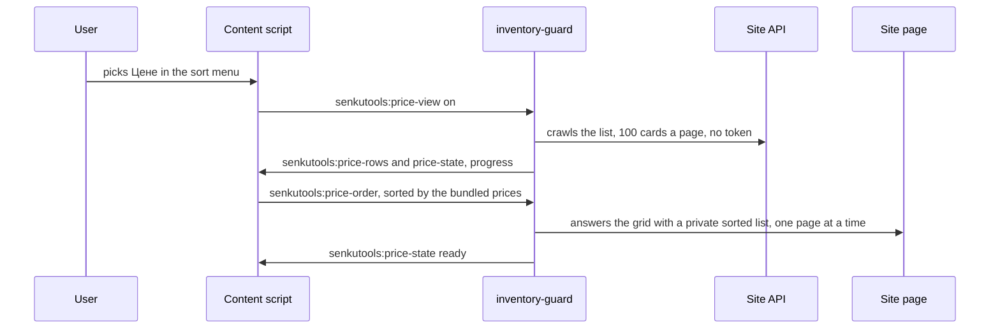
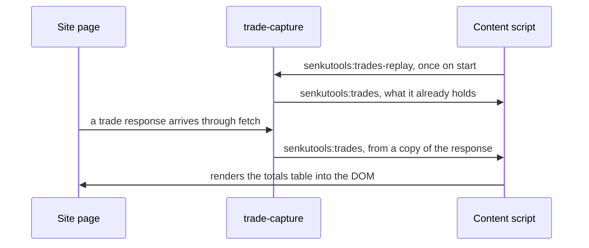
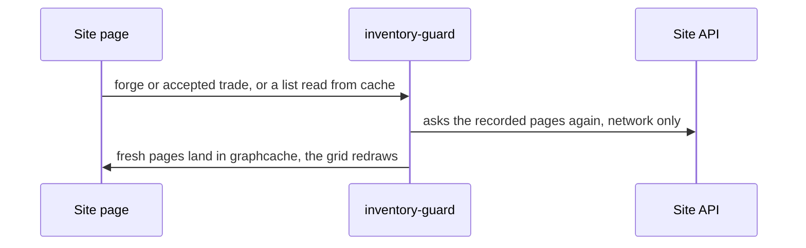
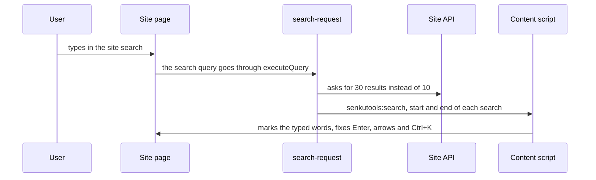
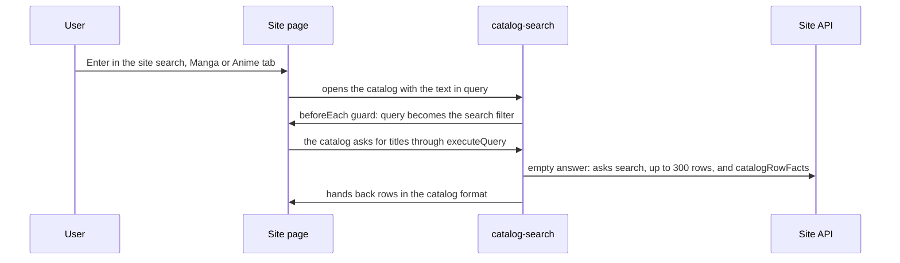
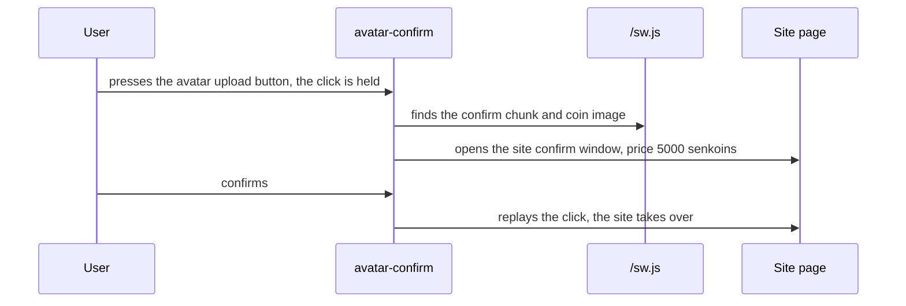
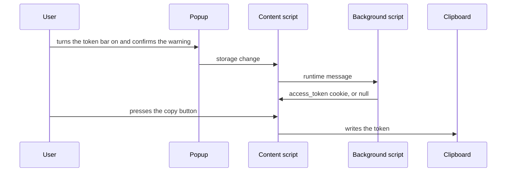

# How it works

English | [Русский](architecture.ru.md)

The components first, then the main flows. Events named `senkutools:` are the messages between the isolated content script and the page-world scripts, and carry strings only. Back to the [README](../README.md).

## Where the code runs

## Sort by price

## Trade totals

## Fresh card lists

## Site search

## Catalog search

## Avatar price warning

## Token bar

